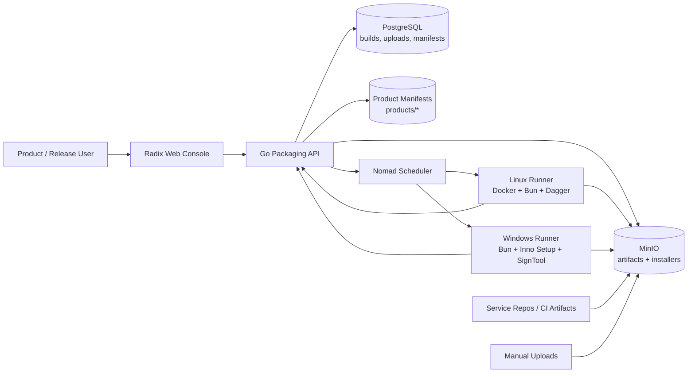
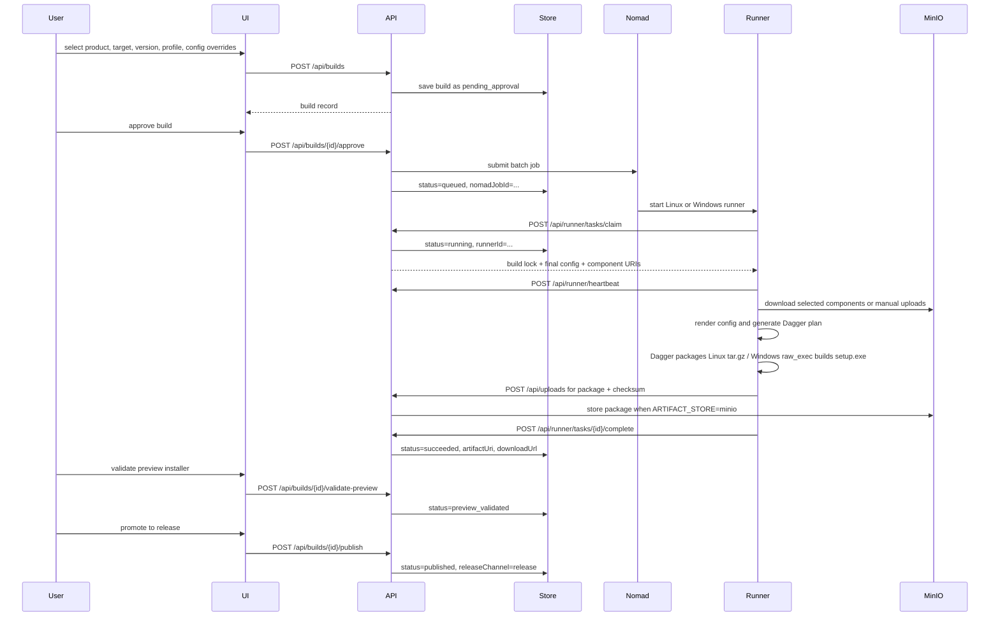
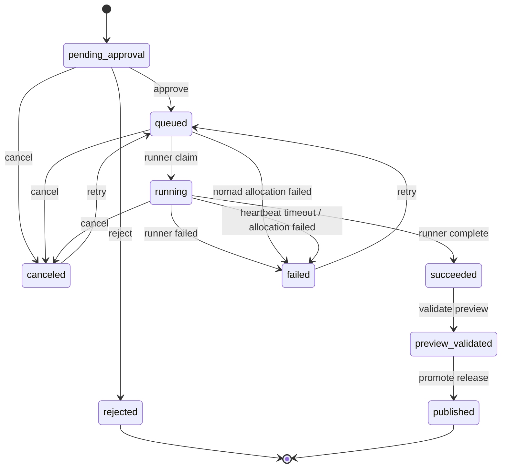
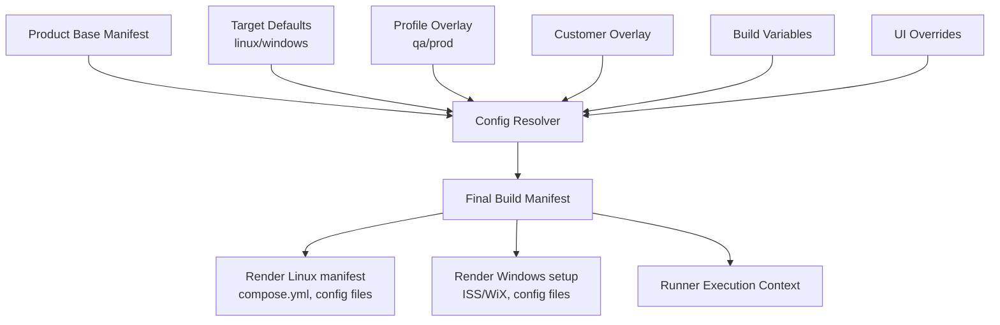
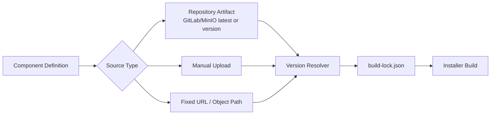
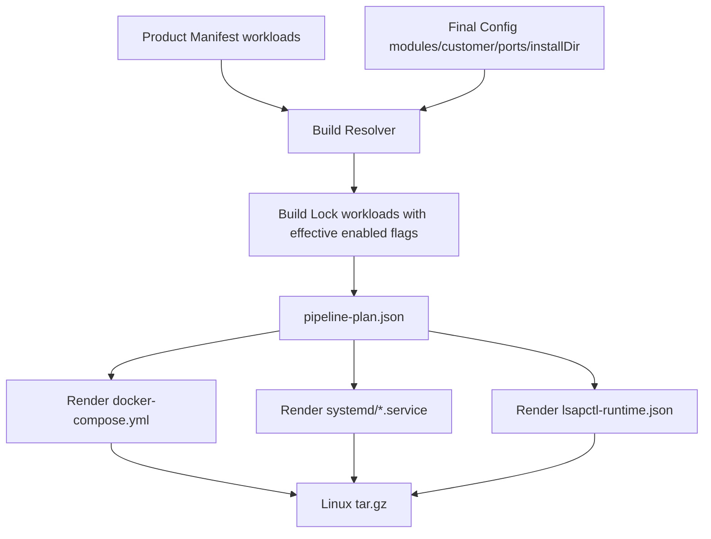

# Packaging Platform Architecture

## Architecture



## Data Flow



## Build State Machine



## Configuration Resolution



Recommended precedence:

```text
UI overrides > pipeline variables > customer overlay > profile overlay > target defaults > product base
```

## Component Source Flow



The lock file is critical. Every build should persist the exact resolved component versions and artifact object paths.

## Workload Rendering Flow



Components define where artifacts come from. Workloads define how artifacts run after installation. Docker and systemd are both first-class workload runtimes.
`lsapctl` is the only package lifecycle manager; generated runtime files are inputs to `lsapctl`, not competing operational scripts.

## Current MVP Coverage

| Requirement | Current status | Notes |
|---|---:|---|
| Product list | Implemented | `GET /api/products`, UI product list |
| Manifest/config management | Implemented | JSON editor, schema validation, dry-run resolver preview, revisions and restore |
| Version selection | Implemented basic | Product manifest has `versions` |
| Build parameters | Implemented | target/profile/customer/channel/version/config/modules/component sources |
| Build records | Implemented | PostgreSQL default storage, JSON fallback available |
| Preview/release gate | Implemented | preview artifact must be validated before release promotion |
| Download address | Implemented | `artifactUri`, `downloadUrl`, build download endpoint |
| Logs | Implemented | runner/system logs and heartbeat |
| Runner claims task | Implemented | `POST /api/runner/tasks/claim` |
| Linux packaging | Implemented MVP | Runner downloads components, renders config, runs optional `LSAPCTL_BUILD_CMD`, creates `tar.gz` |
| Windows packaging | Implemented MVP | Runner supports `WINDOWS_PACKAGER_CMD`; fallback marks placeholder setup output |
| Component repo selection | Implemented MVP | UI and API support repository/manual/fixed/previous-build source kinds |
| Manual upload | Implemented MVP | Upload endpoint, PostgreSQL upload records, local file storage adapter |
| Config override without script changes | Implemented MVP | Resolver merges target/profile/customer/build overrides into build lock |

Release gate enforcement is centralized through the build release check API. The same check set powers the admin dashboard, `validate-preview`, and `publish`, so the UI can show exactly why a build is blocked before the backend rejects the action. Preview validation checks artifact availability, Build Lock presence, Build Lock target/profile/version consistency, and required component locks. Release publishing adds fixed build versions, fixed component versions, exact component URIs without wildcards, artifact availability, and no recorded build error.

## Target Capability

The core goal is that users can change the following without changing build scripts:

- ports
- service versions
- default install directory
- customer name
- license
- database password policy
- module enablement
- component artifact source
- Linux/Windows packaging target

This requires a declarative packaging manifest and renderer pipeline, not hardcoded build scripts.
