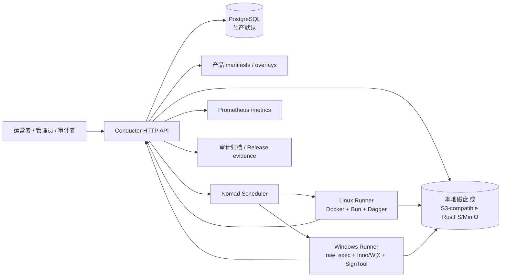
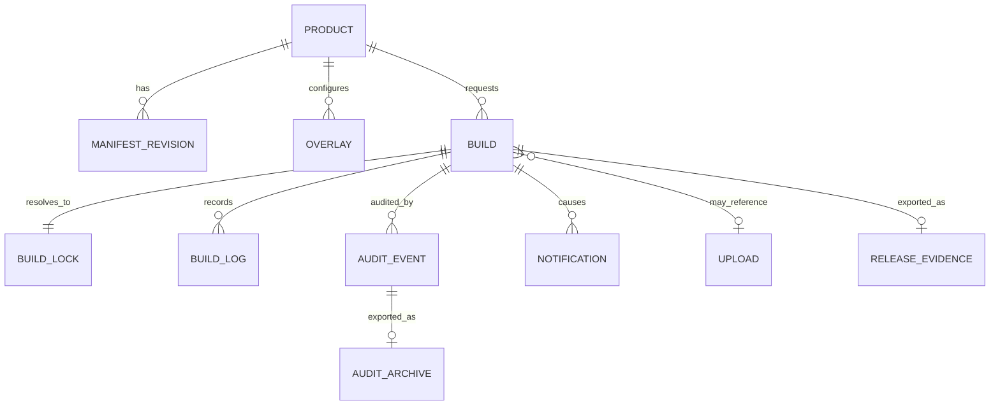
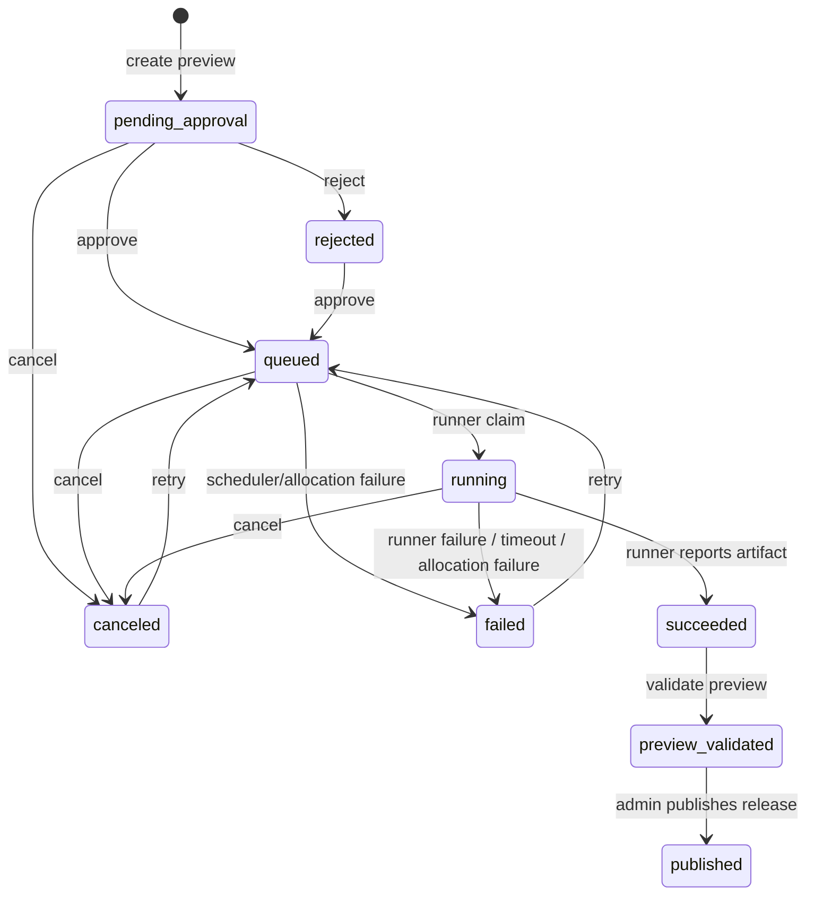
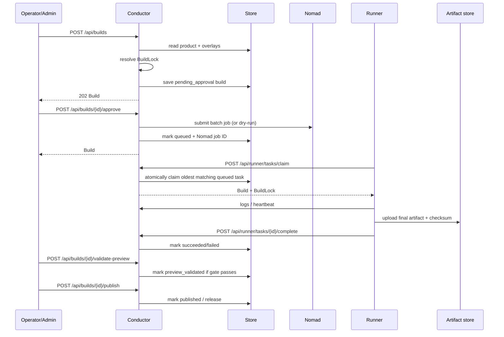
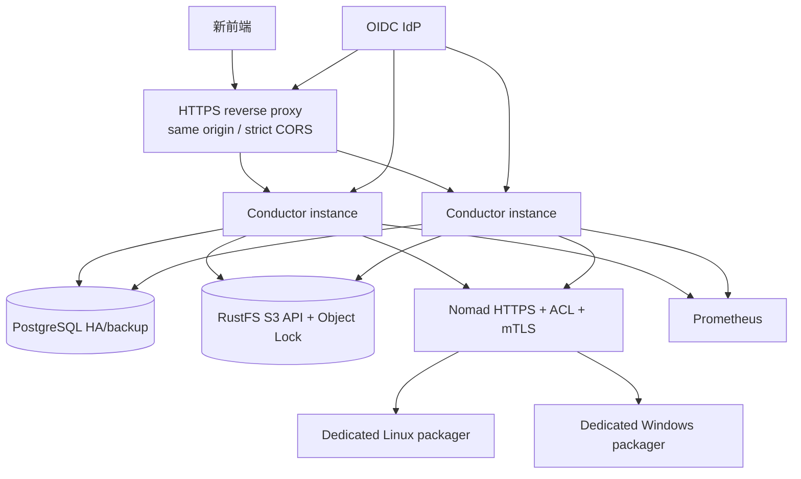

# Vela 后端架构

> 本文定义前端重设计期间保持稳定的后端边界、数据流与运行约束。它以当前实现为准，不把尚未部署或尚未验证的生产能力描述为已具备。
>
> 对浏览器/API 调用方的字段与行为，以 [OpenAPI 契约](openapi.yaml) 为准；实现级错误语义见 [错误处理设计](error-handling.md)。

## 1. 系统定位与边界

Vela 是面向 Linux 与 Windows 安装包的**构建控制平面**。后端负责声明式产品配置、构建状态机、审批与发布门禁、Runner 协调、制品元数据、审计和可复现性证据；实际打包由受控 Runner 执行。



### 后端负责

- 产品 manifest、profile/customer overlay 与 manifest revision；
- 将构建输入解析为不可变的 `BuildLock`；
- Build 生命周期与 Preview → Release 门禁；
- Runner task claim、日志、心跳与完成回调；
- 制品上传元数据、下载权限/保留期，以及审计/发布证据归档；
- Nomad job 提交、取消、轮询协调；
- Bearer/OIDC/session 鉴权、结构化错误、请求关联、指标、通知与审计。

### 后端不负责

- UI 布局、设计系统、页面状态或本地缓存策略；
- Docker/Dagger、Inno/WiX、SignTool 的实际构建实现；
- Nomad、PostgreSQL、对象存储、IdP、Vault、GitLab 的部署与可用性保障；
- 接收或持久化明文前端密码、Runner bearer、签名私钥或对象存储 secret。

前端应把后端看作 REST + SSE 控制平面，而不是直接访问数据库、Nomad 或 RustFS。

---

## 2. 运行时组成

| 组件 | 责任 | 当前实现 |
|---|---|---|
| `cmd/server` | 组装依赖、启动 lifecycle monitor 与 HTTP server | [`conductor/cmd/server/main.go`](../conductor/cmd/server/main.go) |
| `internal/api` | 路由、鉴权、状态转换、错误、SSE、审计、指标 | [`conductor/internal/api/server.go`](../conductor/internal/api/server.go) |
| `internal/domain` | API 与持久化共享模型 | [`conductor/internal/domain/types.go`](../conductor/internal/domain/types.go) |
| `internal/manifest` | 产品 manifest 语义校验 | [`conductor/internal/manifest`](../conductor/internal/manifest) |
| `internal/resolver` | 解析 config/component/workload，生成 BuildLock | [`conductor/internal/resolver`](../conductor/internal/resolver) |
| `internal/store` | PostgreSQL 和 JSON store 抽象 | [`conductor/internal/store`](../conductor/internal/store) |
| `internal/artifact` | 本地/S3-compatible 制品、GitLab package、归档 | [`conductor/internal/artifact`](../conductor/internal/artifact) |
| `internal/nomad` | dry-run / Nomad scheduler adapter | [`conductor/internal/nomad`](../conductor/internal/nomad) |
| `internal/lifecycle` | 心跳、Nomad allocation、通知保留期 reconciliation | [`conductor/internal/lifecycle`](../conductor/internal/lifecycle) |
| `internal/secret` | secret reference 的受控解析 | [`conductor/internal/secret`](../conductor/internal/secret) |
| `runner/` | 从任务 claim 到构建、上传、回调的执行平面 | [`runner`](../runner) |

### 启动顺序

1. 加载环境配置；
2. 初始化 `Store`（默认 PostgreSQL，开发可选 JSON）；
3. 初始化 `Scheduler`（`DRY_RUN=true` 时为 dry-run adapter）；
4. 初始化 artifact store（本地或 S3-compatible）；
5. 启动 lifecycle monitor；
6. 注册 HTTP routes，并监听 `PORT`。

任一 store、scheduler 或 artifact store 初始化失败时，进程会失败退出，避免服务在半配置状态下启动。

---

## 3. 核心领域模型



### Product 与配置

`Product` 是声明式安装包定义，包含：

- `targets` 及其 `targetConfig`；
- `profiles`、可选客户 overlay；
- component source；
- Docker/systemd workload；
- 默认 config。

解析优先级：

```text
request configOverrides
> request variables
> customer overlay
> profile overlay
> target config
> product base config
```

component override 会替换相应 component source。解析结果被写入 `BuildLock`，固定 Build ID、目标、profile、customer、version、配置、具体 component URI/SHA-256（可用时）和 workload 有效状态。前端应展示 BuildLock，但不能自行重新推导或修改已创建构建的锁。

### Build 状态机



直接创建 `releaseChannel=release` 被拒绝。发布只能把已验证的 Preview 提升为 Release。

### Release 门禁

Preview validation 要求：

1. 构建状态为 `succeeded`；
2. channel 为 preview；
3. 有 `artifactUri` 或 `downloadUrl`；
4. 有 BuildLock，且 lock identity 匹配；
5. 所有 required components 都被锁定到 URI。

Release publishing 额外要求：

1. Preview 已验证；
2. 构建版本不是 `latest`；
3. component URI 无 wildcard；
4. component 版本固定；
5. 制品可下载且未记录构建错误。

门禁的机器可读结果通过 `GET /api/builds/{id}/release-check` 返回。前端要以 `checks[].id` / `checks[].status` 做判断，而不是匹配自然语言提示。

---

## 4. 主流程

### 4.1 构建、审批、执行与发布



`POST /api/runner/tasks/claim` 在 PostgreSQL 使用 `FOR UPDATE SKIP LOCKED`，以避免多个 Runner 领取同一个队列项。JSON store 只适用于单进程本地开发，不是多实例生产方案。

### 4.2 制品、证据与保留期

- 上传字节进入本地文件系统或 S3-compatible backend；DB 只保存 upload metadata。
- `UploadRecord` 包含 `sha256`、size、content type、download policy 和 retention metadata。
- download policy：`public`（匿名）、`platform`（viewer+）、`restricted`（operator+）；仅在 `AUTH_ENABLED=true` 时启用角色判断。
- 过期上传下载返回 `410 ARTIFACT_EXPIRED`。
- 审计 archive 和 release evidence 使用 canonical payload 的 SHA-256 内容地址；可选 HMAC signature。
- S3-compatible backend 可在 bucket 已具备 Object Lock 的情况下应用 retention/legal hold。应用侧不会凭空使现有 bucket 具备 WORM 能力。

### 4.3 异步协调

lifecycle monitor 在启动后立即运行、随后按 `RECONCILE_INTERVAL_SECONDS`（默认 30 秒）轮询：

- `running` Build 的 `UpdatedAt` 超过 `RUNNER_TIMEOUT_SECONDS` 时标记为失败；
- 查询 Nomad allocation；失败 allocation 会使 active Build 失败；allocation 在 Runner 回报成功前完成也会被视为失败；
- 清理超过 `NOTIFICATION_RETENTION_DAYS` 的**已读**通知。

SSE 日志流不是消息总线：`GET /api/builds/{id}/logs/stream?follow=true` 每 2 秒轮询持久化日志。前端必须允许断线重连和重复事件；以 `sequence` 做去重。

---

## 5. 存储与外部依赖

### PostgreSQL（生产默认）

PostgreSQL 保存：

- products / manifest revisions；
- builds（可查询列 + 完整 JSON payload）；
- upload records；
- audit events；
- optional auth sessions；
- notifications。

启动时会执行内置 `CREATE TABLE IF NOT EXISTS` migration，并从 `products/*/product.json` seed 产品表。由于 seed 会覆盖同 ID 的 DB manifest，生产发布产品 manifest 时应明确把该行为纳入变更流程。

### JSON store（仅本地）

`STORE_DRIVER=json` 把数据保存到 `DATA_DIR`，并依赖进程内 mutex；没有跨进程锁、事务恢复或高可用保证。它只适合 UI/接口开发和单机验收。

### Artifact store

| 后端 | 用途 | 注意事项 |
|---|---|---|
| local | 本地开发保存 uploads 与 archives | 无 WORM 语义；不能替代生产持久化存储 |
| S3-compatible（配置仍名为 `minio`） | RustFS/MinIO 兼容对象存储 | 需要 endpoint、non-default access key、secret key、bucket、TLS；Object Lock 需 bucket 创建阶段启用 |
| GitLab Generic Packages | component source 解析 | 仅允许 exact package path，后端下载并算 SHA-256 |

浏览器不应直接拥有 S3/RustFS 凭据。所有上传走 `POST /api/uploads`，下载走受控下载 endpoint 或后端返回的已批准 URL。

### Nomad

- `DRY_RUN=true`：批准仅生成模拟 job ID；
- `DRY_RUN=false`：后端提交 batch job 到 Nomad；
- Linux：Docker Runner，可能挂载 Docker socket / Dagger cache；
- Windows：`raw_exec` + PowerShell；
- placement 强制 OS 和 `node_class`；资源、timeout、retry/reschedule 可配置。

这是高信任执行边界。生产必须部署专用节点、ACL/mTLS 和最小权限 workload identity；前端不得代替这些控制或直接调用 Nomad。

### Secret resolution

build config 中 `secret:` / `secret://` 仅作为引用存在。解析器支持 environment、file、SOPS、Vault 和 Nomad Variables。审计记录 ref 名称与计数，禁止记录 value。

**实现边界：**当前代码的实际 secret-to-Nomad 注入方式必须配合生产 rollout 安全模型验证；前端不得读取、回显或尝试验证 secrets。

---

## 6. 安全与访问模型

### 角色

| Role | 典型能力 |
|---|---|
| `viewer` | 审计、通知、受 platform policy 保护的下载、metrics |
| `operator` | viewer 能力 + 产品/overlay 编辑、创建/审批/取消/重试 Build、上传 |
| `admin` | 所有 operator 能力 + publish、Runner API |
| `runner` | 仅内部 Runner claim/log/heartbeat/complete API |

身份可来自 static bearer、RS256 OIDC JWT，或可选 OIDC code+PKCE broker 签发的短期平台 session token。角色判断与具体路径的实现细节见 [OpenAPI 契约](openapi.yaml)。

### 请求关联与错误

- 服务接受或生成 `X-Request-Id` 和 `X-Correlation-Id`，并在 response header、错误、Build log 与 audit event 中带回；
- 错误使用稳定的 `error.code`、`error.details[]`、`requestId`、`correlationId`；
- 业务 UI 不得用英文 `message` 进行逻辑分支；使用 `code` 和 `details[].code`；
- 非 2xx 结构请见 [错误处理设计](error-handling.md)。

### 当前实现的边界与上线前注意项

以下是当前代码事实，不能被前端重设计掩盖：

1. `AUTH_ENABLED=false` 时所有请求视为 admin；该模式仅限本地开发。
2. 多个 GET endpoint 目前没有 `withAuth` 包装，即使启用认证仍可匿名读取。新前端不应假设它们已被 viewer 权限保护；生产应先决定并实施 read-side auth policy。
3. CORS 当前为 `*`，且 allow headers 不含 `Authorization`。跨域 bearer 前端需要 same-origin proxy 或后端 CORS 修复后才可用。
4. `/api/health` 只证明 HTTP handler 存活，不检查 PostgreSQL、Nomad、RustFS/MinIO 或 IdP。
5. Runner API 是内部协议。当前共享 Runner bearer 的 ownership fencing/一次性 capability 必须由已批准的生产安全配置和验收 gate 保障；浏览器不得调用该组 endpoint。
6. HTTP server 当前没有 graceful shutdown / lifecycle cancellation；生产运行环境应通过进程管理、drain 和部署策略补足。

---

## 7. 面向前端重设计的稳定适配边界

### 推荐使用的资源视图

| UI 领域 | API resource | 主键 / 刷新策略 |
|---|---|---|
| 产品目录 | `Product` | `id`；按需刷新 |
| manifest 编辑 | raw `ProductManifest` + `ManifestRevision` | `productId`；保存后重新读取 |
| Build 列表/详情 | `Build` + `ReleaseCheckResult` | `id`；运行期轮询 + SSE log |
| 预览/发布操作 | Build state action endpoints | action 成功后采用 response Build 覆盖本地状态 |
| 上传资产 | `UploadRecord` | `id`；上传后用 response，列表刷新保留期状态 |
| 运行态 | `RunnerStatus` | `runnerId`；短周期轮询 |
| 审计/证据 | `AuditEvent`、`AuditArchive`、`ReproducibilityReport`、`ReleaseEvidenceArchive` | append/read-only；不可由 UI 修改 |
| 通知 | `Notification` | `id`；已读操作后采用 response |

### 兼容性规则

1. JSON 字段使用 `camelCase`；日期时间为 RFC 3339；空字符串与省略字段均可能出现，客户端应容忍。
2. `Build` 的 `releaseCheckSummary` 是后端计算结果，不能客户端伪造。
3. `ManifestDryRunResult` 在 manifest/resolve 不通过时仍返回 HTTP `200` 及 `valid:false`；UI 不能把所有 validation 失败都当 HTTP error。
4. `POST /api/runner/tasks/claim` 的 `204` 表示没有匹配任务，不是失败。
5. build/download endpoint 可返回 `302`，也可在没有 public URL 时返回 `200 { artifactUri }`。
6. upload/download 的认证要求取决于服务设置和 `downloadPolicy`，客户端应处理 `401`、`403` 与 `410`。
7. 发布以及构建状态变化不应在客户端乐观跳转状态；只信任 action response 的 `Build.status`。

---

## 8. 推荐部署拓扑



生产的最低要求：

- HTTPS 在 edge/API 边界；API 与 Nomad 使用 TLS/mTLS；
- `AUTH_ENABLED=true`，禁用开发 static token 策略或把 token 存于受控 secret store；
- PostgreSQL durable storage、backup 和 restore 演练；
- RustFS non-default credentials、TLS、durable volume/replica、Object Lock bucket、WORM negative tests；
- dedicated Linux/Windows Runner、真实 Dagger/Inno/WiX/签名验证；
- Nomad ACL default deny、Conductor/Runner/observer 身份隔离；
- release readiness 报告必须将未执行的 live gate 视为失败。

生产 rollout 的可执行验证边界见 [production-readiness.md](production-readiness.md)。

---

## 9. 变更原则

- 新前端只能通过 [OpenAPI 契约](openapi.yaml) 使用后端，不能依赖 Studio 源码内部细节。
- 新增字段采用可选字段，避免破坏既有客户端；删除/改名需要 API 版本策略。
- 状态转换、release gate、鉴权、artifact download policy 和 audit event 必须保持服务端权威。
- 所有涉及 secret、token、private key、Runner capability、S3 credential 的内容只允许通过受控运行时注入；不得加入 manifest、BuildLock、API response、日志、截图、文档样例或 Git。
