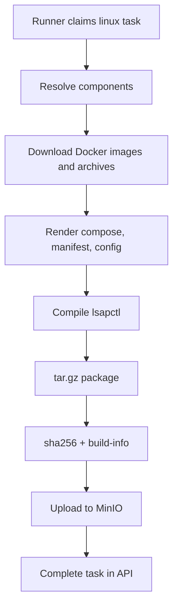
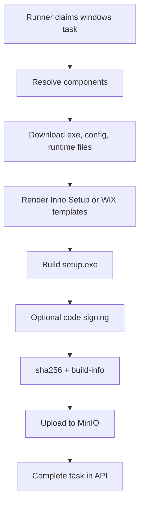

# Core Feature Plan

## Feature Objective

The platform must build Linux and Windows installers from configurable product definitions. Users should select component sources, choose versions, upload custom files, and override product settings without editing build scripts.

## Product Manifest Model

Recommended manifest shape:

```json
{
  "id": "lsap",
  "name": "智能定位平台",
  "targets": {
    "linux": {
      "installDir": "/opt/lsap",
      "packageName": "lsap-linux-x86_64",
      "templates": {
        "compose": "linux/compose.template.yml",
        "manifest": "linux/manifest.template.json"
      }
    },
    "windows": {
      "installDir": "C:\\Program Files\\LSAP",
      "packageName": "lsap-windows-x64-setup",
      "installer": "inno",
      "template": "windows/setup.template.iss"
    }
  },
  "components": [
    {
      "id": "location-engine",
      "type": "docker-image",
      "required": true,
      "source": {
        "kind": "artifact-repository",
        "repository": "minio",
        "path": "artifact/Publish/engine/main/latest/location-engine-*.tar.gz"
      }
    },
    {
      "id": "ui",
      "type": "archive",
      "required": true,
      "source": {
        "kind": "upload",
        "accept": [".zip"]
      }
    }
  ],
  "config": {
    "ports": {
      "web": 48000
    },
    "database": {
      "passwordPolicy": "strong",
      "rootPasswordRef": "secret:mysql-root-password"
    },
    "customer": {
      "name": "Default Customer",
      "license": "community"
    },
    "modules": {
      "camera": true,
      "push": true,
      "map": true
    }
  }
}
```

## Component Source Model

Supported source kinds:

| Kind | Purpose |
|---|---|
| `artifact-repository` | Resolve from MinIO/GitLab package registry by path, glob, version, or latest |
| `manual-upload` | User uploads a file for this build |
| `fixed-url` | Download from an explicit URL |
| `previous-build` | Reuse output from a previous successful build |

Each build must generate:

```json
{
  "buildId": "abc123",
  "components": [
    {
      "id": "location-engine",
      "version": "1.2.3",
      "sourceKind": "artifact-repository",
      "uri": "minio://artifact/Publish/engine/main/latest/location-engine-1.2.3.tar.gz",
      "sha256": "..."
    }
  ]
}
```

This lock file makes builds auditable and reproducible.

## Configuration Overlay Model

Configuration layers:

```text
products/lsap/product.json
products/lsap/targets/linux.json
products/lsap/targets/windows.json
profiles/qa.json
profiles/prod.json
customers/customer-a.json
build request variables
```

Merge order:

```text
product base
-> target defaults
-> profile overlay
-> customer overlay
-> build variables
```

Examples:

```json
{
  "config": {
    "ports": {
      "web": 48001
    },
    "customer": {
      "name": "Customer A",
      "license": "enterprise"
    },
    "modules": {
      "camera": false
    }
  }
}
```

## Rendering Strategy

Use a renderer step before packaging:

```text
final manifest
  -> render docker-compose.yml
  -> render systemd/*.service
  -> render app.conf
  -> render nginx.conf
  -> render Windows ISS/WiX template
  -> render build-info.json
```

Templates should use structured data, not string replacement scattered across scripts. Recommended options:

- Go `text/template` or `html/template` for conductor-rendered files.
- JSON/YAML patching for structured files.
- Strict schema validation before render.

## Workload Model

Components describe artifact sources. Workloads describe how those artifacts run after installation.

Supported Linux workload runtimes:

- `docker` - rendered into `rendered/docker-compose.yml`.
- `systemd` - rendered into `systemd/*.service`.

Example:

```json
{
  "workloads": [
    {
      "id": "location-guard",
      "runtime": "docker",
      "component": "location-guard",
      "module": "map",
      "docker": {
        "image": "location-guard:{{version}}",
        "ports": ["{{ports.web}}:8080"],
        "volumes": ["{{installDir}}/conf/location-guard:/app/conf"]
      }
    },
    {
      "id": "location-worker",
      "runtime": "systemd",
      "component": "location-worker",
      "module": "camera",
      "systemd": {
        "unitName": "lsap-location-worker.service",
        "workingDirectory": "{{installDir}}/services/location-worker",
        "execStart": "{{installDir}}/services/location-worker/location-worker --config {{installDir}}/conf/location-worker.yaml",
        "restart": "always"
      }
    }
  ]
}
```

The resolver stores effective workload state in the build lock. If `module` is set, `config.modules.<module>` can enable or disable the workload without changing build scripts.

## Linux Packaging Pipeline



## Windows Packaging Pipeline



## Phase Plan

### Phase 1 - Manifest and Config Core

Deliverables:

- Product manifest schema.
- Component source model.
- Config overlay merge.
- Build-lock generation.
- UI for product manifest and build variables.
- Status: implemented in MVP.

Acceptance:

- Change port, install directory, customer name, license, module flags from UI/config.
- No build script edit is required.

### Phase 2 - Component Resolution and Upload

Deliverables:

- Component source selection UI.
- MinIO artifact resolver.
- Manual upload endpoint.
- Build-specific upload staging area.
- Component checksum capture.
- Status: manual upload, source override, local `ARTIFACT_ROOT`, MinIO/RustFS exact/wildcard resolver, `.sha256` sidecar, and GitLab Generic Package Registry exact-file resolver are implemented. GitLab wildcard/listing remains optional future work.

Acceptance:

- User can select repository artifact or upload a custom component.
- Build record stores exact source URIs.
- Implemented endpoint coverage:
  - `POST /api/uploads`
  - `GET /api/uploads`
  - `GET /api/uploads/{id}/download`
  - component override map in `POST /api/builds`.

### Phase 3 - Linux Packaging Runner

Deliverables:

- Runner downloads selected components.
- Renderer writes Linux compose/config/manifest.
- Runner compiles `lsapctl`.
- Runner creates Linux `tar.gz`.
- Runner uploads final package, checksum, build-info.
- Status: runner downloads selected components, writes rendered config files, generates `pipeline-plan.json`, and runs the Linux package build through Dagger. Dagger renders Docker Compose, systemd unit files, and `lsapctl-runtime.json`; all install/start/stop/uninstall/status operations are delegated to `lsapctl`. Dagger optionally executes `LSAPCTL_BUILD_CMD`, then creates or delegates the `tar.gz` package. Runner uploads the package and checksum.

Acceptance:

- A Linux package can be built from the platform end to end.

### Phase 4 - Windows Packaging Runner

Deliverables:

- Windows runner support.
- Inno Setup or WiX template rendering.
- Setup exe compilation.
- Optional signing hook.
- Upload final exe, checksum, build-info.
- Status: runner supports Windows target, `WINDOWS_PACKAGER_CMD`, `WINDOWS_SIGNING_CMD`, deterministic setup/signing fixtures, and production host readiness checks. Without a production packager command, placeholder output is only suitable for control-plane tests.

Acceptance:

- A Windows setup exe can be built from the platform end to end.

### Phase 5 - Approval and Release Hardening

Deliverables:

- Approval roles.
- Release channels.
- Publish promotion without rebuild.
- Audit log.
- Artifact retention policy.
- Status: approve/reject/publish/cancel/retry transitions, release channel metadata, role enforcement, audit events, download policy enforcement, upload retention metadata, and release gate checks are implemented.

Acceptance:

- QA builds and release builds are separated and auditable.

### Phase 6 - Production Storage and Operations

Deliverables:

- PostgreSQL storage.
- AuthN/AuthZ.
- Secrets integration.
- Runner heartbeat.
- Retry/cancel.
- Log streaming.
- Status: PostgreSQL is the default active store for products, builds, uploads, build locks, logs, audit events, notifications, and optional auth sessions. JSON store remains available through `STORE_DRIVER=json`. Runner heartbeat, append-only build logs, lifecycle reconciliation, metrics, and alert rules are implemented.

Acceptance:

- Platform can run as a long-lived internal service.
