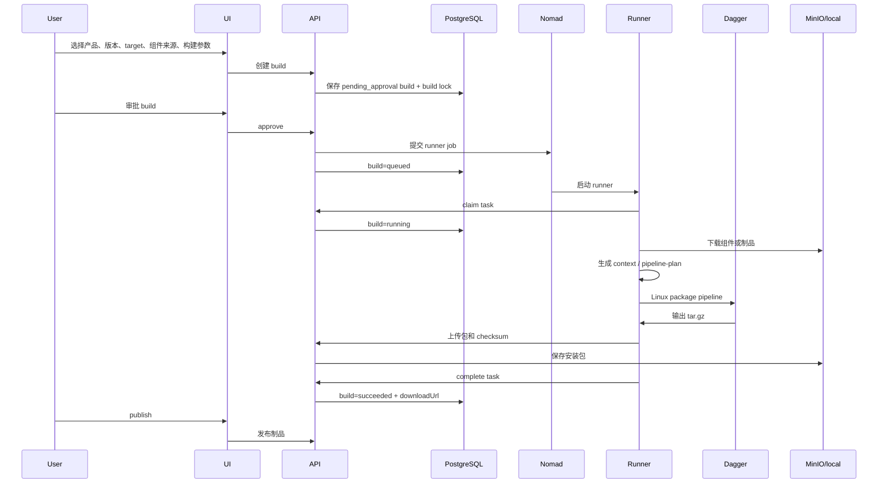

# Vela Development Summary

本文档汇总当前已经确定的设计、需求、实现状态和欠缺项，作为后续继续深入开发的入口。

## 目标

当前平台的目标是做一个可配置的安装包构建系统，而不是为每个产品维护一套独立构建脚本。

核心目标：

- 支持多个产品的 packaging 需求。
- 支持 Linux `tar.gz` 安装包和 Windows `setup.exe` 安装包。
- 通过 manifest/config 描述产品、组件、版本、运行方式和客户化配置。
- 用户可以改端口、服务版本、默认安装目录、客户名称、许可证、数据库密码策略、模块开关和组件来源，不需要改构建脚本。
- 构建任务由 Packaging 系统管理，Runner 只负责执行构建。
- Linux 安装包内只保留 `lsapctl` 作为生命周期管理入口，不再生成 `install.sh`、`start.sh`、`stop.sh`、`uninstall.sh`。

## 当前架构

```text
React admin console with local shadcn/Radix-style primitives
  -> Go Packaging API
  -> PostgreSQL by default, JSON store for local fallback
  -> Nomad
  -> Runner
  -> Dagger for Linux pipeline
  -> local or MinIO/RustFS-compatible artifact store
```

主要组件：

- `conductor/`：Go API，负责产品、manifest、build、upload、approval、publish、runner task、Nomad 调度。
- `studio/`：React 控制台，使用本地 shadcn/Radix-style primitives 和紧凑 dashboard 风格。
- `products/`：产品 manifest 和默认配置。
- `runner/`：Bun 编写的任务执行器，负责领取任务、下载组件、渲染上下文、调用 Dagger 或宿主打包命令、上传结果。
- `lsapctl/`：Go 编写的 Linux 包内 CLI，负责安装、启动、停止、重启、状态、卸载、环境检查。
- `infra/`：Nomad、MinIO、Windows runner 启动脚本等基础设施配置。

详细架构见：

- [Architecture](architecture.md)
- [Core Feature Plan](core-feature-plan.md)
- [Nomad Runner Lifecycle](nomad-runner-lifecycle.md)
- [lsapctl Runtime Contract](lsapctl-runtime.md)

## 数据流



## 已确认需求

平台层需求：

- 产品列表。
- manifest/config 管理。
- 版本选择。
- 构建参数配置。
- 构建记录。
- 审批和发布。
- 下载地址。
- 日志展示。
- 支持组件从仓库选择、从固定 URL 选择、复用历史构建、手动上传。
- 支持 Linux 和 Windows 两类 target。
- 支持通过配置覆盖客户化参数，不修改构建脚本。

Runner 职责：

- 拉取构建任务。
- 下载组件制品。
- 编译 `lsapctl`。
- 打包 Linux `tar.gz`。
- 打包 Windows `setup.exe`。
- 上传结果。
- 回写日志、心跳和构建结果。

Runner 不负责：

- 产品配置编辑。
- 审批流。
- 发布流。
- 构建历史管理。
- 产品 manifest 管理。

这些能力属于 Packaging API 和 UI。

## Manifest 和配置模型

当前设计采用声明式 manifest：

- `components` 描述组件从哪里来。
- `workloads` 描述组件安装后如何运行。
- `config` 描述端口、安装目录、客户信息、许可证、数据库策略、模块开关等。
- `targets` 描述 Linux/Windows 默认参数。
- build request 可以覆盖部分配置。

配置合并优先级：

```text
UI overrides > build variables > customer overlay > profile overlay > target defaults > product base
```

必须支持无需改脚本的配置项：

- 端口。
- 服务版本。
- 默认安装目录。
- 客户名称。
- 许可证。
- 数据库密码策略。
- 是否启用模块。
- 组件制品来源。
- Linux/Windows target。

当前已经加强：

- manifest 保存、dry-run 和构建创建的核心校验。
- 常用配置项的结构化编辑和高级 JSON 模式。
- `secret:<name>` / `secret://<name>` 引用解析，支持 env/file/SOPS/Vault KV v2/Nomad Variables backend。
- Manifest revision、restore、diff 和独立 audit event。
- Build Lock、release gate 和可复现报告。

仍需按实际使用频率继续加强：

- uncommon Docker/systemd nested fields 的结构化编辑。
- 更细粒度 schema/version compatibility。
- 生产级 live acceptance 和长期保留策略。

## Linux 安装包设计

Linux 包的生命周期全部委托给 `lsapctl`。

包内推荐结构：

```text
lsapctl
rendered/lsapctl-runtime.json
rendered/docker-compose.yml
rendered/install-config.json
rendered/build-lock.json
rendered/workloads.json
systemd/*.service
components/*
```

明确不生成：

```text
install.sh
start.sh
stop.sh
uninstall.sh
```

`lsapctl` 当前能力：

- 默认读取 `rendered/lsapctl-runtime.json`。
- 支持 `doctor`、`install`、`start`、`stop`、`restart`、`status`、`uninstall`、`completion`。
- 支持 Docker Compose workload。
- 支持 systemd workload。
- 支持单个 workload 操作：`--workload <id>`。
- 支持交互选择安装目录。
- 未指定安装目录时使用 manifest `installDir`，否则默认 `/opt/lsap`。
- 目标目录存在且非空时提示确认。
- 支持安装前备份。
- 支持动态 sudo 提权。
- 支持 `--yes`、`--no-elevate`、`--dry-run`、`--verbose`。

权限策略：

- `doctor`、`status`、`help`、`completion` 通常不需要 sudo。
- `install`、`uninstall` 需要 root。
- `start`、`stop`、`restart` 如果包含 systemd workload，需要 root。
- Docker-only 操作不强制 root，但当前用户必须能访问 Docker daemon。
- 需要 root 且当前不是 root 时，`lsapctl` 会提示是否通过 `sudo` 重新执行。
- `--yes` 会允许自动 sudo 重新执行。
- `--no-elevate` 会禁用自动提权并返回明确错误。

## Nomad 和 Runner 生命周期

当前设计中 Nomad 是任务调度器，Runner 不是长期固定绑定在 API 内部的进程。

Linux Runner：

- 通过 Nomad Docker driver 启动。
- Runner 容器内执行 Bun 脚本。
- Linux packaging pipeline 通过 Dagger 定义和运行。
- Dagger pipeline 负责编译 `lsapctl`、渲染 Linux runtime 文件、输出 `tar.gz`。

Windows Runner：

- 通过 Nomad `raw_exec` 在 Windows 宿主机上启动。
- 需要 Windows 宿主环境安装 Bun、Inno Setup 或 WiX、可选 SignTool。
- Windows setup.exe 的真实打包依赖 `WINDOWS_PACKAGER_CMD`。
- Windows setup.exe 的签名依赖 `WINDOWS_SIGNING_CMD`；runner 会在 checksum 和上传前执行该 hook。
- 当前不强行把 Windows 打包塞进 Linux 容器，因为 setup.exe、签名和厂商运行库通常依赖 Windows 宿主工具链。

生命周期要求：

- approve 后提交 Nomad job。
- runner claim 后 build 进入 running。
- runner 周期性 heartbeat。
- Nomad allocation failed/lost 时 build 失败。
- heartbeat 超时 build 失败。
- cancel 会注销 Nomad job。
- retry 会提交新的 Nomad job。

## 当前实现状态

| 模块 | 状态 | 说明 |
|---|---|---|
| 产品列表 | 已实现 MVP | API 和 UI 已有产品读取 |
| manifest/config 管理 | 已实现 MVP | 支持 JSON 编辑和核心字段覆盖 |
| 版本选择 | 已实现基础能力 | 产品 manifest 中定义版本 |
| 构建参数 | 已实现 MVP | target/profile/customer/channel/config/modules/component source |
| 构建记录 | 已实现 MVP | PostgreSQL 为默认存储 |
| 审批/发布 | 已实现 MVP | approve/reject/publish/cancel/retry |
| 下载地址 | 已实现 MVP | artifactUri/downloadUrl |
| 日志展示 | 已实现 MVP | runner 追加日志，UI 可查看 |
| 手动上传 | 已实现 MVP | upload endpoint 和本地/MinIO 存储适配 |
| 组件来源选择 | 已实现 MVP | repository/manual/fixed/previous-build |
| Linux packaging | 已实现 MVP | Bun runner + Dagger + tar.gz |
| Windows packaging | MVP | 支持 target、`WINDOWS_PACKAGER_CMD`、`WINDOWS_SIGNING_CMD`、fixture 验收和生产主机 readiness check；真实 Release 仍依赖 Windows packager host 和证书链 |
| Nomad 调度 | 已接入 | 支持 Linux Docker driver、Windows raw_exec、资源/日志/重启/重调度策略 |
| PostgreSQL | 已接入 | JSON store 仅保留本地 fallback |
| MinIO/RustFS | 已接入 MVP | 支持源制品解析、最终制品上传、审计归档和可选 object-lock 验收 |
| `lsapctl` | 已实现 MVP | Docker/systemd 生命周期、权限、安装目录、备份、状态 |
| 前端体验 | 已重做 MVP | PC dashboard 风格、中文 UI、结构化 Manifest/Build/Upload/Runner/Notification/Reproducibility 主要流程已覆盖 |

## 主要欠缺项

产品和配置：

- uncommon Docker/systemd nested fields 仍主要依赖高级 JSON。
- secret 引用已经接入 env/file/SOPS/Vault KV v2/Nomad Variables；如生产需要，可继续增加云 KMS 原生 backend。
- customer/profile overlay 已有独立管理页面；target config 主要在 Manifest 结构化编辑中维护。
- build lock、release gate 和可复现报告已经在 UI/API 中展示。

组件和制品：

- GitLab Generic Package Registry exact-file resolver、MinIO/RustFS exact/wildcard resolver 和 local `ARTIFACT_ROOT` resolver 已实现。
- 手动上传已有权限、512 MB API 限制、checksum、download policy 和 retention metadata。
- 下载权限已按 `public/platform/restricted` 在 auth mode 下执行。
- 最终安装包已有 checksum；Windows signing hook 已实现，真实证书签名仍需生产 Windows host 验收。
- SBOM 仍未纳入当前 MVP。

Runner 和 Dagger：

- Linux Dagger pipeline 已有 fixture/golden path 和 `fixture_golden_cli.py` 确定性校验；仍需要更多真实产品 fixture 矩阵。
- Dagger cache、Bun cache、组件缓存需要可观测和清理策略。
- Runner 需要并发控制。
- Runner 需要更清晰的错误分类和重试策略。
- 已有 Python 一键本地验收脚本，支持 local/RustFS/Windows fixture 路径。
- Windows packaging 仍需要在真实 Windows host 上补齐 Inno Setup 或 WiX 生产验收。

Nomad 和宿主环境：

- Nomad job spec 已包含资源限制、ephemeral disk、allocation log rotation、kill timeout、max run duration、restart/reschedule policy 和 cache mount。
- Linux runner host 需要安装和运维文档。
- Windows runner host 需要服务化启动、权限、签名证书和工具链文档。
- 需要验证 allocation failed、lost、cancel、retry 的完整闭环。

`lsapctl`：

- `status --json` 目前还不够完整，需要输出所有 workload 的结构化状态。
- Docker 权限不足时目前由 doctor 报错，后续可以增加更精确的提权建议。
- CentOS/RHEL 的 systemd、SELinux、firewalld 检查需要更细。
- install/upgrade/rollback 需要明确版本迁移策略。
- 备份目前有基础能力，缺少 restore 命令。
- Docker Compose service 级 restart/status 需要更完整的输出解析。
- runtime manifest 需要 schema 校验和兼容版本策略。

安全和治理：

- AuthN/AuthZ MVP 已实现：静态 token、OIDC/JWKS、server-side broker、persisted session store/logout、角色权限和 runner token。
- 审批、发布、Manifest 写入、上传、下载和 runner API 已有角色边界。
- 独立 audit event、archive digest/HMAC signing、archive storage、可选 object-lock evidence 和前端 audit center 已实现。
- Secret management MVP 已实现：env/file/SOPS/Vault KV v2/Nomad Variables。
- 缺少多租户或团队隔离模型。
- 缺少发布通道策略和不可变制品策略。

测试和质量：

- Go conductor tests、Python script tests、studio unit tests、Playwright E2E、runner entry build check 已作为当前验证门。
- Runner 已有 fixture 路径和 acceptance CLI；仍需更多真实文件/产品矩阵。
- Dagger pipeline 已有 fixture-based testing 和 fixture golden CLI；仍可增加更多 base image/golden archive。
- `lsapctl` 需要 Linux 容器/VM 集成测试。
- Nomad lifecycle 需要本地 docker-compose 或脚本化验证。
- Windows setup.exe 需要专门的 Windows runner 验证。

前端：

- 前端已改为 dashboard admin 风格，PC 优先。
- 产品、build、manifest、logs、approval、upload、runner、notification、reproducibility 已有主要信息架构。
- 配置编辑已支持结构化表单 + 高级 JSON 模式。
- 日志支持列表和 stream；复制/下载仍可后续增强。
- 构建记录已展示状态、runner、artifact、失败原因和 release gate 摘要。

## 建议后续 Phase

### Phase 1: 稳定 manifest 和 build lock

目标：

- 完成产品 manifest schema。
- 完成 runtime manifest schema。
- 完成 config override 类型定义。
- build 创建时做强校验。
- build lock 页面可读展示。

验收：

- 修改端口、安装目录、客户、许可证、模块开关、组件来源后，生成的 build lock 明确可审计。
- 无效配置不能进入审批流。

### Phase 2: 打通 Linux 端到端真实构建

目标：

- 用真实组件 fixture 构建 Linux `tar.gz`。
- 验证 Dagger pipeline。
- 验证 `lsapctl doctor/install/start/status/stop/uninstall`。
- 增加 Linux 集成测试脚本。

验收：

- 在一台干净 Linux 主机上可以下载包、执行 `./lsapctl install`、启动 Docker/systemd workload、查看状态、卸载。

### Phase 3: 完善 Nomad 生产生命周期

目标：

- 完整验证 queued/running/succeeded/failed/canceled/retry。
- 完善 heartbeat timeout 和 Nomad allocation reconciliation。
- 增加 runner 并发控制和资源限制。
- 补齐 Linux/Windows runner host 文档。

验收：

- 任意 runner 失败、宿主机断开、任务取消，都能在平台中得到正确状态。

### Phase 4: 补齐 Windows setup.exe

目标：

- 选择 Inno Setup 或 WiX 作为首个正式方案。
- 渲染 setup 模板。
- 支持可选代码签名。
- 输出 checksum 和 build-info。

验收：

- Windows Nomad client 上能真实生成 setup.exe，并上传到平台。

### Phase 5: 安全、权限和发布治理

目标：

- 接入登录。
- 增加角色权限。
- 增加审批审计。
- 管理 secret 引用。
- 发布通道和制品不可变策略。

验收：

- 普通用户、审批人、管理员、runner token 权限边界清晰。

### Phase 6: 前端重构和治理入口

目标：

- 已完成产品列表、构建创建、配置编辑、构建详情、日志、审批发布、上传、Runner、通知和可复现报告的 dashboard 化。
- 使用本地 shadcn/Radix-style primitives 建立统一布局和组件规范。
- 用结构化表单承载大部分配置，保留高级 JSON 编辑。
- 后续补 visual regression 和更多大表单拆分。

验收：

- 用户能不看文档完成一次产品选择、配置修改、审批、构建、下载、Preview 验证和 Release 发布。

## 下一步推荐

优先顺序建议：

1. 在真实生产 IdP 上跑 live acceptance，确认 token claims、角色映射、session store/logout 和 HTTPS 配置。
2. 在 production-like RustFS/MinIO bucket 上跑 object-lock live acceptance，固化 retention policy。
3. 在 Windows host 上跑真实 Inno/WiX + SignTool Preview 验收。
4. 根据生产密钥体系决定是否增加云 KMS 原生 backend 和 refresh-token rotation。
5. 补可选 visual regression 和更多 runner fixture matrix。
