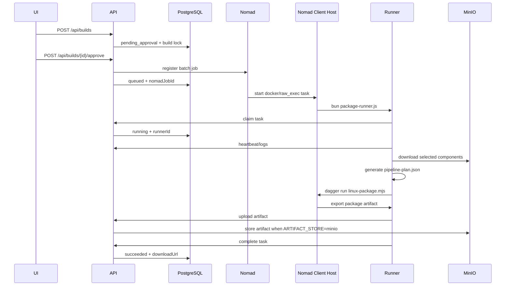

# Nomad Runner Lifecycle

## Control Plane

The Packaging API runs as the control plane.

Required services:

- PostgreSQL
- Nomad server
- MinIO when `ARTIFACT_STORE=minio`
- Packaging API

API variables for real Nomad scheduling:

```bash
STORE_DRIVER=postgres
DRY_RUN=false
NOMAD_ADDR=http://127.0.0.1:4646
PACKAGING_API_URL=http://<api-host>:8080
ARTIFACT_STORE=minio
MINIO_ENDPOINT=<minio-host>:9000
MINIO_ACCESS_KEY=<access-key>
MINIO_SECRET_KEY=<secret-key>
MINIO_BUCKET=packaging-artifacts
MINIO_PUBLIC_URL=http://<minio-host>:9000
```

Proxy variables are inherited by the API process and forwarded into Nomad runner tasks:

```bash
HTTP_PROXY=http://proxy.internal:8080
HTTPS_PROXY=http://proxy.internal:8080
NO_PROXY=localhost,127.0.0.1,<api-host>,<minio-host>,<nomad-host>
```

## Linux Runner Host

Linux packaging runs through Nomad Docker driver.

Host requirements:

- Nomad client
- Docker
- Docker socket access for Dagger, or a configured `DAGGER_RUNNER_HOST`
- network access to Packaging API and MinIO
- runner image available locally or in a registry

Build the runner image:

```bash
cd runner
docker build -t packaging-runner:local .
```

Start a Linux Nomad client:

```bash
sudo nomad agent -config infra/nomad/linux-client.hcl
```

Recommended Linux host cache directories:

```bash
sudo mkdir -p /var/cache/packaging/{bun,dagger,artifacts}
sudo chmod -R 0777 /var/cache/packaging
```

API variables that control Linux runner cache mounts:

```bash
RUNNER_BUN_CACHE_DIR=/var/cache/packaging/bun
RUNNER_DAGGER_CACHE_DIR=/var/cache/packaging/dagger
ARTIFACT_ROOT=/var/cache/packaging/artifacts
DAGGER_DOCKER_SOCKET=/var/run/docker.sock
```

The client is selected by:

```hcl
meta {
  node_class = "linux-packager"
}
```

The API-created Nomad job also constrains:

```hcl
attribute = "${attr.kernel.name}"
operator  = "="
value     = "linux"
```

## Windows Runner Host

Windows setup packaging runs through Nomad `raw_exec`. This is intentional: Inno Setup, WiX, SignTool, and vendor runtimes are normally host-installed Windows tools.

Host requirements:

- Windows Server or Windows workstation dedicated as a packaging node
- Nomad client
- Bun in `PATH`
- Inno Setup or WiX installed when real setup.exe output is required
- optional SignTool and signing certificate
- network access to Packaging API and MinIO
- proxy variables configured at process or service level when outbound access requires a proxy

Prepare runner files:

```powershell
powershell -ExecutionPolicy Bypass -File infra\windows\prepare-runner.ps1 `
  -RunnerDir C:\packaging-runner `
  -ApiUrl http://<api-host>:8080 `
  -MinioPublicUrl http://<minio-host>:9000 `
  -WindowsPackagerCmd 'iscc C:\packaging-runner\context\rendered\setup.iss'
```

Start Windows Nomad client as Administrator:

```powershell
powershell -ExecutionPolicy Bypass -File infra\windows\start-nomad-client.ps1 `
  -NomadExe C:\tools\nomad\nomad.exe `
  -ServerAddr <nomad-server-ip>:4647
```

Recommended Windows cache directories:

```powershell
New-Item -ItemType Directory -Force -Path C:\packaging-cache\bun | Out-Null
New-Item -ItemType Directory -Force -Path C:\packaging-cache\artifacts | Out-Null
```

Configure proxy/cache variables before starting Nomad or in the Windows service environment:

```powershell
[Environment]::SetEnvironmentVariable("HTTP_PROXY", "http://proxy.internal:8080", "Machine")
[Environment]::SetEnvironmentVariable("HTTPS_PROXY", "http://proxy.internal:8080", "Machine")
[Environment]::SetEnvironmentVariable("NO_PROXY", "localhost,127.0.0.1,<api-host>,<minio-host>,<nomad-host>", "Machine")
[Environment]::SetEnvironmentVariable("BUN_INSTALL_CACHE_DIR", "C:\packaging-cache\bun", "Machine")
[Environment]::SetEnvironmentVariable("ARTIFACT_ROOT", "C:\packaging-cache\artifacts", "Machine")
```

The client is selected by:

```hcl
meta {
  node_class = "windows-packager"
}
```

The API-created Nomad job also constrains:

```hcl
attribute = "${attr.kernel.name}"
operator  = "="
value     = "windows"
```

## Job Lifecycle



## Failure Handling

- Nomad submit failure: approval returns a failed build.
- Nomad allocation failure/lost: lifecycle monitor marks the build failed.
- Runner heartbeat timeout: lifecycle monitor marks the build failed.
- Runner process error: runner reports failed through `/api/runner/tasks/{id}/complete`.
- Canceling a queued/running build deregisters the Nomad job.
- Retrying a failed/canceled build registers a fresh Nomad job version and returns the build to `queued`.

Controls:

```bash
RUNNER_TIMEOUT_SECONDS=1800
RECONCILE_INTERVAL_SECONDS=30
NOMAD_LINUX_NODE_CLASS=linux-packager
NOMAD_WINDOWS_NODE_CLASS=windows-packager
WINDOWS_RUNNER_COMMAND='bun C:\packaging-runner\package-runner.js'
RUNNER_BUN_CACHE_DIR=/var/cache/packaging/bun
RUNNER_DAGGER_CACHE_DIR=/var/cache/packaging/dagger
DAGGER_DOCKER_SOCKET=/var/run/docker.sock
```
