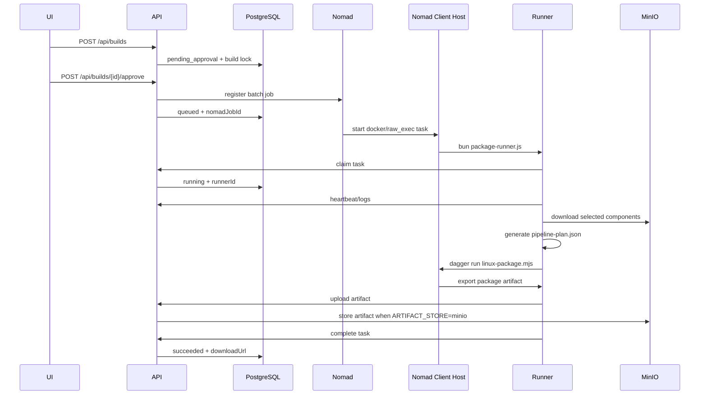

# Nomad Runner Lifecycle

## Auth-enabled E2E evidence

For each actual dispatch, Conductor persists dispatch identity/JTI/expiry, writes the task-owned secure Nomad Variable, then submits the Job. Linux templates render bearer and execution capability into `$NOMAD_SECRETS_DIR` at `0400`; Windows `raw_exec` uses allocation secrets-directory ACLs, not POSIX permissions. Never serialize either into `Task.Env`, `runner.env`, allocation logs, Build/audit records, reports, or artifacts.

`python scripts/runner_e2e_cli.py check --fixture --json` is automatic protocol evidence, not deployment proof. After a real allocation completes, run `PACKAGING_OPERATOR_TOKEN=... NOMAD_TOKEN=... python scripts/runner_e2e_cli.py check --live --api-url ... --nomad-url ... --build-id ... --nomad-job-id ...`; credentials are intentionally not accepted in argv. The gate cross-checks protected Conductor evidence with the real Nomad batch Job and completed allocations. Cancellation, timeout, failure, completion, or retry invalidates the old capability; legacy artifacts remain unverified and cannot satisfy Preview/Release verification.


## Control Plane

The Packaging API runs as the control plane.

Required services:

- PostgreSQL
- Nomad server
- RustFS when `ARTIFACT_STORE=minio`（该配置名保留为既有 S3 适配器兼容层）
- Packaging API

API variables for real Nomad scheduling:

```bash
STORE_DRIVER=postgres
DRY_RUN=false
NOMAD_ADDR=https://nomad.service.consul:4646
NOMAD_TOKEN=<conductor-client-token>
NOMAD_CACERT=/run/secrets/nomad/ca.pem
NOMAD_CLIENT_CERT=/run/secrets/nomad/client.pem
NOMAD_CLIENT_KEY=/run/secrets/nomad/client-key.pem
PACKAGING_API_URL=http://<api-host>:8080
# Required for auth-enabled real scheduling; keep only in the API/Conductor environment.
AUTH_ENABLED=true
AUTH_RUNNER_TOKEN=<runner-static-bearer>
PACKAGING_API_TOKEN_FILE=vela-runner-auth
ARTIFACT_STORE=minio
# RustFS is the local/live test service. MINIO_* remains the existing S3 adapter namespace.
MINIO_ENDPOINT=<rustfs-host>:9000
MINIO_ACCESS_KEY=<rustfs-access-key>
MINIO_SECRET_KEY=<rustfs-secret-key>
MINIO_BUCKET=packaging-artifacts
MINIO_PUBLIC_URL=http://<rustfs-host>:9000
```

With `AUTH_ENABLED=true` and `DRY_RUN=false`, Conductor rejects startup without `AUTH_RUNNER_TOKEN`. For each dispatch it stores the bearer in the job's task-owned Nomad Variable path, and the task workload identity renders it through a non-`env` template into `$NOMAD_SECRETS_DIR/vela-runner-auth`. Linux template mode is `0400`; Windows uses the allocation secrets-directory ACL and makes no POSIX-mode claim. The bearer must never be added to `runner.env`, task environment, Build/Audit records, workspace, or logs.

Proxy variables are inherited by the API process and forwarded into Nomad runner tasks:

```bash
HTTP_PROXY=http://proxy.internal:8080
HTTPS_PROXY=http://proxy.internal:8080
NO_PROXY=localhost,127.0.0.1,<api-host>,<minio-host>,<nomad-host>
```

## Linux Runner Host

Linux packaging runs through Nomad Docker driver.

Host requirements:

- Nomad client
- Docker
- Docker socket access for Dagger, or a configured `DAGGER_RUNNER_HOST`
- network access to Packaging API and MinIO
- runner image available locally or in a registry

Build the runner image:

```bash
cd runner
docker build -t packaging-runner:local .
```

Start a Linux Nomad client:

```bash
sudo nomad agent -config infra/nomad/linux-client.hcl
```

Recommended Linux host cache directories:

```bash
sudo mkdir -p /var/cache/packaging/{bun,dagger,artifacts}
sudo chmod -R 0777 /var/cache/packaging
```

API variables that control Linux runner cache mounts:

```bash
RUNNER_BUN_CACHE_DIR=/var/cache/packaging/bun
RUNNER_DAGGER_CACHE_DIR=/var/cache/packaging/dagger
ARTIFACT_ROOT=/var/cache/packaging/artifacts
DAGGER_DOCKER_SOCKET=/var/run/docker.sock
```

API variables that control Nomad production job policy:

```bash
RUNNER_CPU=2000
RUNNER_MEMORY_MB=4096
RUNNER_MEMORY_MAX_MB=0
RUNNER_DISK_MB=4096
RUNNER_LOG_MAX_FILES=10
RUNNER_LOG_MAX_FILE_MB=20
RUNNER_KILL_TIMEOUT_SECONDS=30
RUNNER_MAX_RUN_SECONDS=3600
RUNNER_RESTART_ATTEMPTS=0
RUNNER_RESCHEDULE_ATTEMPTS=0
RUNNER_DOCKER_PRIVILEGED=false
```

Default retry policy is intentionally strict: Nomad does not automatically restart or reschedule failed packaging tasks. The platform records the failed build and operators retry through the API/UI after fixing the root cause. Increase restart/reschedule attempts only for environments where runner startup failures are known to be transient and idempotent.

The client is selected by:

```hcl
meta {
  node_class = "linux-packager"
}
```

The API-created Nomad job also constrains:

```hcl
attribute = "${attr.kernel.name}"
operator  = "="
value     = "linux"
```

Linux installation checklist:

1. Install Nomad and Docker on the runner host.
2. Join the host to the Nomad cluster with `infra/nomad/linux-client.hcl`.
3. Create cache directories under `/var/cache/packaging`.
4. Build or pull the runner Docker image on the host.
5. Configure the API with `DRY_RUN=false`, `NOMAD_ADDR`, `PACKAGING_RUNNER_IMAGE`, `PACKAGING_API_URL`, `MINIO_PUBLIC_URL`, and Linux cache variables.
6. Submit one preview Linux build and verify the job appears in Nomad.
7. Confirm the build detail page shows runner logs, artifact metadata, and passing Preview gate checks.

Recommended production Linux runner variables:

```bash
PACKAGING_RUNNER_IMAGE=packaging-runner:<version>
PACKAGING_RUNNER_COMMAND='bun /app/package-runner.js'
NOMAD_LINUX_NODE_CLASS=linux-packager
RUNNER_BUN_CACHE_DIR=/var/cache/packaging/bun
RUNNER_DAGGER_CACHE_DIR=/var/cache/packaging/dagger
ARTIFACT_ROOT=/var/cache/packaging/artifacts
DAGGER_DOCKER_SOCKET=/var/run/docker.sock
LSAPCTL_SOURCE_DIR=/opt/vela/lsapctl
LSAPCTL_BUILD_CMD='cd /workspace/context/lsapctl-src && GOOS=linux GOARCH=amd64 go build -o "$OUTPUT_DIR/lsapctl" .'
```

## Windows Runner Host

Windows setup packaging runs through Nomad `raw_exec`. This is intentional: Inno Setup, WiX, SignTool, and vendor runtimes are normally host-installed Windows tools.

Host requirements:

- Windows Server or Windows workstation dedicated as a packaging node
- Nomad client
- Bun in `PATH`
- Inno Setup or WiX installed when real setup.exe output is required
- optional SignTool and signing certificate
- network access to Packaging API and MinIO
- proxy variables configured at process or service level when outbound access requires a proxy

Prepare runner files:

```powershell
powershell -ExecutionPolicy Bypass -File infra\windows\prepare-runner.ps1 `
  -RunnerDir C:\packaging-runner `
  -ApiUrl http://<api-host>:8080 `
  -MinioPublicUrl http://<minio-host>:9000 `
  -WindowsPackagerCmd 'iscc C:\packaging-runner\context\rendered\setup.iss'
```

Start Windows Nomad client as Administrator:

```powershell
powershell -ExecutionPolicy Bypass -File infra\windows\start-nomad-client.ps1 `
  -NomadExe C:\tools\nomad\nomad.exe `
  -ServerAddr <nomad-server-ip>:4647
```

Recommended Windows cache directories:

```powershell
New-Item -ItemType Directory -Force -Path C:\packaging-cache\bun | Out-Null
New-Item -ItemType Directory -Force -Path C:\packaging-cache\artifacts | Out-Null
```

Configure proxy/cache variables before starting Nomad or in the Windows service environment:

```powershell
[Environment]::SetEnvironmentVariable("HTTP_PROXY", "http://proxy.internal:8080", "Machine")
[Environment]::SetEnvironmentVariable("HTTPS_PROXY", "http://proxy.internal:8080", "Machine")
[Environment]::SetEnvironmentVariable("NO_PROXY", "localhost,127.0.0.1,<api-host>,<minio-host>,<nomad-host>", "Machine")
[Environment]::SetEnvironmentVariable("BUN_INSTALL_CACHE_DIR", "C:\packaging-cache\bun", "Machine")
[Environment]::SetEnvironmentVariable("ARTIFACT_ROOT", "C:\packaging-cache\artifacts", "Machine")
```

The client is selected by:

```hcl
meta {
  node_class = "windows-packager"
}
```

The API-created Nomad job also constrains:

```hcl
attribute = "${attr.kernel.name}"
operator  = "="
value     = "windows"
```

Windows installation checklist:

1. Install Nomad, Bun, and the selected Windows installer toolchain.
2. Run `infra\windows\prepare-runner.ps1` to copy runner files and generate `runner.env`; it deliberately does not write `AUTH_RUNNER_TOKEN`. Auth-enabled dispatched tasks receive the token only via Nomad's allocation secrets directory.
3. Configure persistent cache directories such as `C:\packaging-cache\bun` and `C:\packaging-cache\artifacts`.
4. Set proxy and cache variables at Machine scope when required.
5. Start the Nomad client as Administrator with `infra\windows\start-nomad-client.ps1`.
6. Create and approve one preview Windows build.
7. Verify raw_exec starts the runner, the runner claims the task, and the generated `setup.exe` is uploaded.
8. From the allocation's controlled verification task, run the Windows live gate with the allocation ID, build/job IDs, a low-privilege `NOMAD_TOKEN`, a human `PACKAGING_OPERATOR_TOKEN`, and the task SID supplied as `NOMAD_TASK_SID`. The gate must confirm that only the declared task identity plus permitted host administrators can access the bearer/capability files; do not place either token in `runner.env`.

Production Windows builds should configure a real packager command. Without `WINDOWS_PACKAGER_CMD`, the runner produces a placeholder setup file only for local control-plane tests. If production releases require signed installers, configure `WINDOWS_SIGNING_CMD`; the runner executes it after the setup file is generated and before checksum/upload.

Example:

```powershell
[Environment]::SetEnvironmentVariable(
  "WINDOWS_PACKAGER_CMD",
  "iscc C:\packaging-runner\context\rendered\setup.iss",
  "Machine"
)

[Environment]::SetEnvironmentVariable(
  "WINDOWS_SIGNING_CMD",
  "signtool sign /fd SHA256 /tr http://timestamp.digicert.com /td SHA256 %OUTPUT%",
  "Machine"
)
```

`WINDOWS_PACKAGER_CMD` receives `OUTPUT` and must write the final `setup.exe` to that path. `WINDOWS_SIGNING_CMD` receives `OUTPUT`, `ARTIFACT`, `BUILD_ID`, `PRODUCT_ID`, `TARGET`, and `VERSION`; it should sign in place or replace the file at the same path. Any non-zero exit code fails the build before the artifact is uploaded.

## Job Lifecycle



## Failure Handling

- Nomad submit failure: approval returns a failed build.
- Nomad allocation failure/lost: lifecycle monitor marks the build failed.
- Runner heartbeat timeout: lifecycle monitor marks the build failed.
- Runner process error: runner reports failed through `/api/runner/tasks/{id}/complete`.
- Canceling a queued/running build deregisters the Nomad job.
- Retrying a failed/canceled build registers a fresh Nomad job version and returns the build to `queued`.

Lifecycle reconciliation can be checked without a live Nomad cluster by running the deterministic fake-scheduler acceptance tests:

```bash
python scripts/lifecycle_cli.py check
python scripts/lifecycle_cli.py check --full-conductor
```

The check covers Nomad failed allocations, premature Nomad completion before runner success, runner heartbeat timeout, terminal-build safety, and scheduler inspection errors. Live cluster verification should still be run after Nomad topology changes.

Live Nomad cluster readiness can be checked separately:

```bash
python scripts/nomad_check_cli.py check \
  --production \
  --address "$NOMAD_ADDR" \
  --ca-cert "$NOMAD_CACERT" \
  --client-cert "$NOMAD_CLIENT_CERT" \
  --client-key "$NOMAD_CLIENT_KEY" \
  --require-token \
  --require-acl \
  --require-mtls \
  --require-linux-node \
  --require-windows-node
```

This check calls Nomad's leader, node stub, and node detail APIs, verifies at least one ready node, and can require ready nodes with `meta.node_class=linux-packager` and `meta.node_class=windows-packager`. `--require-acl` proves anonymous node reads and ACL administration are denied while a non-management client token can read nodes. `--require-mtls` proves the configured CA/client identity works and the server rejects a request without the client certificate. Token material should be provided through `NOMAD_TOKEN`, not argv. For an explicitly accepted internal HTTP cluster, `--allow-http` records the exception, but it is not mTLS evidence.

## Deployment Verification

Use the same verification flow for Linux and Windows:

1. `nomad node status` shows the runner node and node class.
2. The Packaging API is running with `DRY_RUN=false`.
3. The admin console can create and approve a target-specific preview build.
4. `nomad job status <job-id>` shows the submitted runner job.
5. Runner logs show task claim, heartbeat, component downloads, package creation, checksum upload, and artifact upload.
6. The build reaches `succeeded`.
7. `GET /api/builds/{id}/release-check` reports Preview readiness.
8. The admin console can validate Preview. Release promotion remains blocked until fixed versions and exact component URIs are present.
9. `python scripts/lifecycle_cli.py check --full-conductor` passes in CI or deployment verification.
10. `python scripts/nomad_check_cli.py check --production --address "$NOMAD_ADDR" --require-token --require-acl --require-mtls --require-linux-node --require-windows-node` passes against the live cluster with `NOMAD_CACERT`, `NOMAD_CLIENT_CERT`, and `NOMAD_CLIENT_KEY` configured.

If a build is stuck:

- Check API logs for scheduler submit errors.
- Check Nomad allocation logs for runner startup failures.
- Check network access from the runner host to `PACKAGING_API_URL` and `MINIO_PUBLIC_URL`.
- Check `RUNNER_TIMEOUT_SECONDS` and runner heartbeat logs.
- Retry only after fixing the environment issue that caused the failure.

## Upgrade Strategy

Linux runner upgrades are image based:

1. Build and publish a new `PACKAGING_RUNNER_IMAGE` tag.
2. Restart the API with the new image value.
3. New approvals use the new image; existing allocations continue with their original image.
4. Roll back by restoring the previous image tag and retrying failed or canceled builds.

Windows runner upgrades are file based:

1. Stop new approvals or drain the Windows Nomad node.
2. Back up `C:\packaging-runner`.
3. Re-run `prepare-runner.ps1`.
4. Run `C:\packaging-runner\run-once.ps1` against a test queued build.
5. Re-enable the Windows Nomad node.

Controls:

```bash
RUNNER_TIMEOUT_SECONDS=1800
RECONCILE_INTERVAL_SECONDS=30
RUNNER_CPU=2000
RUNNER_MEMORY_MB=4096
RUNNER_MEMORY_MAX_MB=0
RUNNER_DISK_MB=4096
RUNNER_LOG_MAX_FILES=10
RUNNER_LOG_MAX_FILE_MB=20
RUNNER_KILL_TIMEOUT_SECONDS=30
RUNNER_MAX_RUN_SECONDS=3600
RUNNER_RESTART_ATTEMPTS=0
RUNNER_RESCHEDULE_ATTEMPTS=0
RUNNER_DOCKER_PRIVILEGED=false
NOMAD_LINUX_NODE_CLASS=linux-packager
NOMAD_WINDOWS_NODE_CLASS=windows-packager
WINDOWS_RUNNER_COMMAND='bun C:\packaging-runner\package-runner.js'
RUNNER_BUN_CACHE_DIR=/var/cache/packaging/bun
RUNNER_DAGGER_CACHE_DIR=/var/cache/packaging/dagger
DAGGER_DOCKER_SOCKET=/var/run/docker.sock
```
